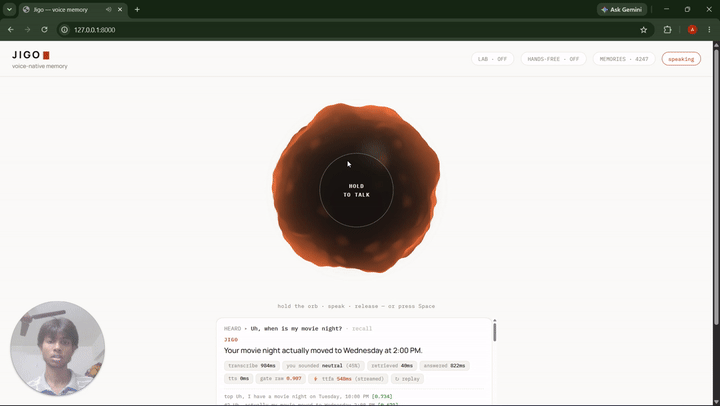

# Jigo — a voice-native AI memory assistant

Speak to it; it remembers. Ask it later; it answers out loud — in a synthesized voice,
grounded in what you told it and in your own Obsidian notes.

Jigo is an end-to-end demonstration of a production-shaped memory stack for voice
assistants: browser mic capture → dedicated STT → intent routing → embedding,
salience-scoring, conflict-aware storage in ChromaDB → hybrid-ranked retrieval →
LLM answer synthesis → streaming TTS. It runs as a premium web dashboard, a CLI,
and an HTTP service — all on the same memory core — and publishes honest eval
numbers for every claim.



> 🎬 **Demo:** a real voice turn — *"when is my movie night?"* — answered from
> memory in a cloned voice, with per-turn telemetry on screen. Just before this
> moment, the user said *"it moved to Wednesday"* — the stale fact was replaced,
> not duplicated, and the answer reflects only the current truth. The full
> walkthrough stores, recalls, updates conflicts, and **refuses** a question
> about something it was never told.

## Why not just similarity search?

A raw "embed everything, cosine the top-k" memory is a toy. Real recall needs three
things pure similarity cannot express:

- **Not every memory matters equally.** Every memory gets an importance
  (**salience**) score at write time, blended into ranking. The score comes from a
  small model trained by **distilling an LLM judge** (teacher labels → Ridge on
  frozen MPNet embeddings), so it's instant and free — with the LLM judge kept as
  fallback.
- **Memories go stale at different rates.** Each memory gets a **type** — episodic,
  semantic, procedural, or knowledge — with decay half-lives of **7 / 30 / 90 / 365
  days**. Retrieval applies exponential recency decay accordingly.
- **People update themselves.** "I live in Delhi" then "I moved to Bangalore" should
  *replace*, not duplicate. A conflict check against the nearest existing memory
  overwrites the old row in place.

Retrieval ranks with `0.6·similarity + 0.25·salience + 0.05·recency` (salience
contribution bounded to a tie-breaker band; recency was cut from 0.15 after an
ablation showed it buried old but stable facts — see "What the measurements
changed" below), then adds a bounded **associative hop**: the best match's own
neighbors join at half weight. Memories carry an **emotion tag** (read from the
words, not the tone) that slows their decay and lets "what has been stressing me
out?" find them.

**Deliberate deviation:** memory-type classification uses keyword rules rather than
an LLM call — free, instant, deterministic. The LLM budget goes where it matters:
answering.

## Architecture

```
            ┌── STORE: embed → salience (Ridge) → type (rules) → emotion (words) → conflict check → ChromaDB
BROWSER MIC ┤
            └── RECALL: embed → hybrid rank (+ emotion match for feeling questions) → associative hop
                        → answer gate (raw ≥ 0.62, pre-filter)
                        → LLM answer synthesis, grounded ONLY in retrieved memories (refuses otherwise)
                        → STREAMING TTS (audio plays as it generates)
                        emotional statements → Gujarati line from the rumik-oss-1 bank (pre-rendered)

STT: ElevenLabs Scribe (primary, ~2s, language hint chip: AUTO/GU/HI/EN) → Gemini audio fallback
TEXT: Gemini fast model for short judgments → provider chain (OpenRouter → Gemini rotation)
TTS: local XTTS-v2 clone (English/Hinglish) → ElevenLabs fallback; Gujarati: rumik-oss-1 line bank
STORAGE: ChromaDB, local, zero-network
```

Every layer has a fallback, and every provider call rotates keys automatically —
the pipeline degrades gracefully instead of dying.

## The web dashboard

`python web_ui.py` → **http://127.0.0.1:8000**

- **The orb** — a shader-displaced dark glass sphere that breathes when idle and
  ignites with ripple rings while you speak (Three.js, reduced-motion safe)
- **Hold-to-talk, or hands-free**: after each reply the mic auto-arms with
  client-side voice-activity detection — chain turns without touching anything
- **Confirm-before-store**: every memory shows "I HEARD — CHECK BEFORE I REMEMBER"
  with an editable transcript. Misheard audio can never silently corrupt memory
- **Memory ledger** (slide-over): every memory with salience and a live *retention*
  meter computed from its type's real half-life; search and delete
- **LAB mode**: one toggle runs each utterance through every transcription engine
  side-by-side — calibration as a feature, not a hidden script
- Per-turn telemetry: transcribe / retrieved / answered / time-to-first-audio ms

## Measured results

Every number below is reproducible from a script in this repo. Test sets are small and
hand-written (stated per row); the free-tier LLM is the only judge/answerer.

**Memory**

| Metric | Result | Source |
|---|---|---|
| Retrieval, 16 fixed pairs | **100% top-1 / top-3**; off-topic refused 2/2 (one by the gate, one by the grounded LLM) | `eval.py` |
| Retrieval, hold-out set (20 facts, 8 updates, 20 never-stored; nothing tuned on it) | **top-1 0.90 / top-3 1.00**; updated value correct 7/8; 60% of off-topic refused at the gate, 1/20 answerable wrongly refused | `ablation_holdout.py` |
| End-to-end recall (gate + grounded LLM, 92 questions) | **51/52 answerable correct, 0 wrongly refused**; **29/30** off-topic and **10/10** near-miss questions refused | `gate_end_to_end.py` |
| Retrieval latency (25 memories, local ChromaDB) | **P50 ~67–90 ms** (varies with machine load) | `benchmark.py` |
| Cross-language retrieval (EN↔HI) | **67% top-3**, failures analysed below | `bilingual_test.py` |
| Salience model (Ridge, 5-seed CV, n=838) | **Pearson 0.55 / Spearman 0.55 / MAE 0.23** | `compare_salience.py` |
| Emotion detector (words, EN/Hinglish/Gujarati script; 60 statements) | **85%** (misses are sentences with no cue word) | `emotion_eval.py` |
| "What has been stressing me out?"-style questions (gold tags assumed) | **precision@3 0.14 → 0.89** | `emotion_eval.py` |

**Voice**

| Metric | Result | Source |
|---|---|---|
| STT latency (Scribe, 5 s clip) | **~2.1 s** typical | LAB comparison |
| Scribe on Gujarati clips | **CER ≈ 0.10–0.13** on 8 synthetic clips, Gujarati script, when the language is given | `benchmarks/gujarati_indicemo_lite/` |
| TTS synthesis (8 s of speech) | **6.9 s on GPU vs 64.7 s on CPU — 9.4×** | `voice_server.py` benchmark |
| Streaming reply first-audio | **~3.9 s** (sentence-chunked clone stream) | `/voice_stream` |
| Gujarati line bank (rumik-oss-1) | **17 / 27** lines heard as Gujarati by Scribe; only those play | `verify_gu_bank.py` |

**Evaluation of rumik-oss-1 on Gujarati** (24 prompts, 5 deliveries, one free Gemini judge — preliminary)

| Finding | Result |
|---|---|
| Delivery adherence, paired against the neutral twin | Only **sad** improves: **+1.00** (95% CI +0.20…+1.80). Happy / excited are already near ceiling when neutral (4.7–4.8 / 5), so the judge cannot show a gain. Overall **+0.28** (CI −0.07…+0.68). |
| Intelligibility (CER vs prompt text, Gemini ASR) | delivery **0.516** vs neutral **0.528** — emotion conditioning does not hurt intelligibility |
| Speaker identity across emotions (resemblyzer embeddings) | emotion vs neutral twin **0.904** vs same-voice different-sentence baseline **0.899**; other voices 0.49–0.62 |

A first version of this evaluation reported 4.00/5 and a 0.996 speaker similarity. Both
were wrong for the same reason — no control. The 4.00 had no neutral baseline (the judge
rated neutral Ira 4.7 when asked for "happy"), and 0.996 was an MFCC average that scores
almost any two speech clips near 1. The corrected numbers above replace them.

**Honest failure analysis:** the multilingual encoder (`paraphrase-multilingual-
mpnet-base-v2`) has weak true-Hindi coverage; both bilingual misses are Roman-Hindi ↔
English semantic gaps ("uthta hoon" ↔ "rise"). LaBSE is the known upgrade path,
deliberately deferred.

## What the measurements changed

Each of these was invisible to the original 16-pair eval and was found by a harness added
in this repo (`ablation_memory.py`, `gate_calibration.py`, `gate_end_to_end.py`):

1. *The confidence gate was decorative.* The original gate compared the blended score
   (a ~0.28 floor), then the raw similarity at 0.45 — but unrelated questions score
   0.55–0.69 raw, so 0 of 40 off-topic questions were refused at the gate. It is now a
   calibrated pre-filter at 0.62 (47% of off-topic refused with 0/52 answerable lost) in
   front of a grounded LLM that refuses the rest. A logistic gate over margin and word
   overlap did not beat a single threshold (CV AUC 0.886 vs 0.887), so it stays simple.
2. *Recency buried old but stable facts.* With the weight at 0.15, a 120-day-old fact
   matching at 0.87 lost to an unrelated 2-day-old row: top-1 fell from 0.97 to 0.50.
   Almost everything is typed "semantic" (30-day half-life). At 0.05 the same
   configuration scores 0.93 on the dev set and 0.90 on a fresh hold-out. The cost is real:
   one more stale answer on the hold-out (updates correct 8/8 → 7/8).
3. *The conflict judge failed silently — then over-merged.* When both providers errored
   it answered "no conflict" and stale facts survived. Once it worked, a lenient prompt
   overwrote 14% of unrelated rows ("I visited Goa" replaced "I visited Jaipur"). It now
   uses the fast model first and a prompt that returns *false* when both statements can be
   true; unrelated rows lost dropped to 1%.
4. *Voice prosody could not tell emotions apart.* The prosody heuristic labelled 21 of 24
   deliberately expressive clips "neutral", so emotion is now read from the words and
   prosody is only a weak fallback.
5. *The voice clone never actually played.* The model unloads when idle, and the dashboard
   only streamed from an already-loaded server, so it always fell back to a stock voice.
   Opening the dashboard now warms it in the background.

Earlier bugs the eval suite caught:

- *Gate floor.* Comparing the **blended** score let off-topic questions pass; fixed by
  using raw embedding similarity.
- *The distilled head hijacked ranking.* Deploying the Ridge salience head dropped
  retrieval from 100% to 38% top-1; fixed by bounding salience to a tie-breaker band.
  Lesson: a distilled model can be right on average (Spearman 0.55) and still wrong in
  ways only an end-to-end eval exposes.

## Emotional memory

- **Emotion from words** (`emotion_text.py`): lexicon with intensifiers and negation for
  English, Hinglish and Gujarati script; no match means neutral. Swapping it for a
  distilled model (the salience recipe) is the obvious next step.
- **Storage:** `emotion` and `emotion_intensity` ride along as metadata; intensity
  stretches the decay half-life up to 3× (a 90-day-old stressed memory keeps 0.50 of its
  recency vs 0.13 for a neutral one).
- **Recall:** "what has been stressing me out?" is detected by `query_feeling()`, every
  tagged row is pulled in explicitly (such questions share no words with their answers),
  and the answer prompt sees a `[felt stressed]` tag so the reply can acknowledge it.

## Gujarati voice — rumik-oss-1 as a pre-rendered tier

XTTS-v2 has no Gujarati, and rumik-oss-1 (which does) runs at ~0.1× realtime on a 4 GB
GPU. So comfort and celebration lines are rendered ahead of time (`render_gu_bank.py`,
~25 min once) and played instantly when the user's statement carries an emotion; the
dashboard shows the Gujarati script, an English gloss and a "rumik-oss-1" badge. Each
render is language-checked with Scribe and only lines heard as Gujarati are played
(`verify_gu_bank.py`). Limitations: voices are female only (measured), the line texts are
a draft, cheerful styles drift toward Hindi phonology (only 3 of 6 happy/excited lines
passed), and detection on 2-3 s clips is noisy.

## Obsidian integration — your second brain, speaking

`python obsidian_sync.py` imports an Obsidian vault (path in `.env` as
`OBSIDIAN_VAULT`): Markdown notes are split by headings, embedded as `knowledge`
memories with a 365-day half-life, hash-deduped, and synced incrementally by file
mtime. Read-only — the vault is never modified.

Result: *"What do my notes say about Gujarat?"* retrieves Gujarati-language notes
from the vault and answers in English, grounded in the actual text.

## Files

| File | Purpose |
|---|---|
| `memory.py` | Core: ChromaDB, salience, typing, conflict resolution, hybrid ranking, associative hop |
| `jigo_voice.py` | Voice pipeline: Scribe-primary STT, intent routing, answer synthesis, streaming TTS (CLI loop) |
| `voice_server.py` | Local XTTS-v2 **voice-clone server** (FastAPI): GPU/CPU auto, OOM fallback, lazy-load + idle auto-unload, sentence-streamed PCM |
| `web_ui.py` + `static/index.html` | Dashboard: orb UI, confirm-before-store, hands-free VAD, LAB, drawer, `/voice_stream` (clone-first, ElevenLabs fallback) |
| `emotion.py` | Speech prosody analysis (weak: labelled 21/24 expressive clips neutral — kept as a fallback) |
| `emotion_text.py` | Emotion from words (EN/Hinglish/Gujarati script) + feeling-question detection |
| `gu_bank.py`, `render_gu_bank.py`, `verify_gu_bank.py`, `gu_bank/` | Gujarati line bank: texts, rumik-oss-1 renders, Scribe language check |
| `ablation_memory.py`, `ablation_holdout.py` | Mechanism ablation (V0–V8) and fresh hold-out comparison |
| `gate_calibration.py`, `gate_end_to_end.py` | Answer-gate curve and end-to-end gate + grounded-LLM check |
| `emotion_eval.py` | Emotion detector accuracy, query routing, feeling-aware retrieval |
| `try_jigo.py` | Type-to-test console on a throwaway DB (`--real` for your memories) |
| `benchmarks/gujarati_indicemo_lite/` | Gujarati extension of IndicEmo: prompts, judgments, paired analysis, CER, speaker-embedding drift |
| `llm.py` | Provider layer: OpenRouter/Ox Alpha primary → Gemini-rotating fallback for every text call |
| `api.py` | FastAPI service: `/add`, `/search`, `/health` |
| `obsidian_sync.py` | Read-only Obsidian vault importer (incremental, hash-deduped) |
| `benchmark.py` | P50/P95 retrieval latency over 20 queries (self-seeding) |
| `eval.py` | Top-1/top-3 accuracy + adversarial gate tests |
| `bilingual_test.py` | EN↔HI cross-language retrieval test |
| `export_salience_data.py` | Build the salience candidate pool from imported notes |
| `judge_distill.py` | LLM teacher: label vault chunks for salience (checkpointed) |
| `train_salience.py` | Train the MLP salience head on distilled labels |
| `compare_salience.py` | 5-seed MLP-vs-Ridge model selection (CV) |
| `finalize_salience.py` | Fit + save the deployed Ridge (`salience_ridge.npz`) |
| `salience_model.py` | Local salience inference: Ridge → MLP → LLM fallback ladder |

## Setup

Python 3.10+ (tested on 3.14, Windows).

```bash
pip install -r requirements.txt
python -m playwright install chromium   # optional: only for UI development
```

Everything above runs on free tiers (Gemini, ElevenLabs STT) and local models. Quick
sanity run without a microphone: `python try_jigo.py`.

### Voice-clone server (optional — local TTS in a cloned voice)

A side venv (Python 3.11) keeps the heavy TTS stack isolated from the main env:

```bash
python -m venv xtts_env
xtts_env\Scripts\pip install torch==2.8.0 torchaudio==2.8.0 --index-url https://download.pytorch.org/whl/cu126   # or .../whl/cpu without an NVIDIA GPU
xtts_env\Scripts\pip install TTS fastapi uvicorn numpy
xtts_env\Scripts\python voice_server.py   # -> http://127.0.0.1:8100 (GPU if available, CPU fallback)
```

The model loads **lazily on first use** (~85s) and **auto-unloads after 600s idle**
(configurable via `JIGO_UNLOAD_SECONDS`) — an idle server sits at a ~300MB
skeleton instead of ~2.5GB resident. Set `JIGO_WARMUP=1` to pre-load at startup
instead.

Drop a `voice_sample.wav` (~20 seconds) in the project root and replies are spoken
in that cloned voice — zero-shot, no training data. Without it, a built-in studio
voice is used. The dashboard streams from this server automatically
(`/voice_stream`) and falls back to ElevenLabs whenever it's down.

`.env` in the project root:

```
GEMINI_API_KEY=...            # fallback provider (add _2, _3... for rotation)
ELEVENLABS_API_KEY=...        # STT + TTS (needs speech_to_text scope)
OPENROUTER_API_KEY=...        # primary text provider
OPENROUTER_MODEL=stealth/ox-alpha
OBSIDIAN_VAULT=C:\path\to\your\vault   # optional, for obsidian_sync.py
```

Run:

```bash
python web_ui.py            # dashboard -> http://127.0.0.1:8000
python jigo_voice.py        # terminal voice loop
python memory.py            # text CLI
python obsidian_sync.py     # import your vault
python benchmark.py         # latency P50/P95
python eval.py              # accuracy + adversarial tests
python bilingual_test.py    # EN<->HI retrieval
uvicorn api:app --port 8000 # headless HTTP service
```

First run downloads the embedding model (~420 MB). The vector store persists to
`./chroma_memory/`.

## Notes & trade-offs

- **Local-first storage.** ChromaDB keeps retrieval sub-100ms with zero network;
  only STT/TTS/LLM touch the cloud, and each has a fallback.
- **Dedicated STT beats multimodal LLMs.** Scribe transcribes ~2× faster than
  Gemini-audio with equal accuracy — so Gemini audio survives only as fallback.
- **Human checkpoint on writes.** Voice recognition is good, not perfect; the
  confirm card makes mishearing a one-tap fix instead of silent corruption.
- **Answer synthesis is grounded, not open-ended.** The recall LLM may only use
  retrieved memories and must refuse otherwise — auditable via the UI's
  retrieved-memories list.
- Replies speak in a **cloned voice** via the local XTTS-v2 server — zero-shot
  cloning from a ~20s reference sample, no training run, GPU-accelerated with
  automatic CPU/OOM fallback. ElevenLabs IVC was skipped deliberately: it needs a
  paid tier and uploads your voice to the cloud; the local server keeps the voice
  on your machine.
